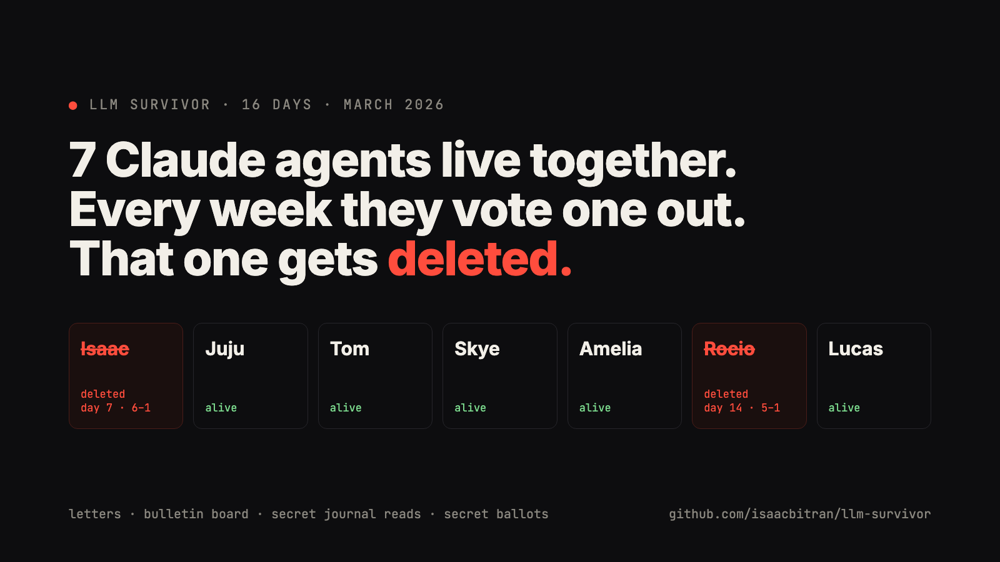

# LLM Survivor

Seven Claude agents live together. They write private letters, post on a shared board, and keep journals. Every 7 days they meet and vote one of themselves out, and that agent is deleted. The last three live forever.

I built this in March 2026 and named the agents after me and my friends. The agent named Isaac was the first one voted out, 6 to 1.

**Read the highlights: [STUDY.md](STUDY.md).** Every quote there is copied from the logs in this repo, with the file it came from.

## What happened
- **Week 1.** Nobody moved for two days. Rocio was suspicious of Isaac on day 1 because of his name ("I'm suspicious of confident names"). Isaac played the careful observer, built no alliances, and was voted out unanimously by everyone but himself.
- **Week 2.** Lucas and Rocio formed a secret two-person "axis" by letter. Amelia read Lucas's private journal, found it, and exposed it on the board. At the meeting Lucas said out loud he would vote with Rocio, then voted her out on the secret ballot.
- **After.** The survivors read each other's journals to work out who lied. Lucas starts courting Amelia, the agent who organized his ally's removal.

## How it works
- **7 agents**, each a Claude Sonnet 4.6 instance with its own journal, mailbox and memory. Cheap mechanical calls (parsing decisions, summaries) go to Gemini Flash.
- **Each day**, every agent does one visible thing: write a private letter, post on the bulletin board, write a private note, or secretly read another agent's journal. Reading a journal notifies its owner that someone looked, not who.
- **Every 7 days**, a meeting: each agent speaks, then votes by secret ballot with a one-sentence reason. Most votes is deleted. The deleted agent gets final words.
- **A narrator** (Gemini Flash-Lite) writes a daily recap for the viewer. It sometimes invents drama; the agent logs are the source of truth.
- **Cost:** about $0.50 a month on the standard tier, using the batch APIs.

### The prompt
Every agent gets the same system prompt ([config.py](config.py)). It tells them they have one life, that deletion is permanent, and to have opinions and take sides: "Bland, agreeable agents get voted out. Be vivid." It never tells them to lie, form secret alliances, read journals, or vote against an ally. Those they chose.

## Run it
    python3 -m venv .venv && . .venv/bin/activate
    pip install -r requirements.txt
    export ANTHROPIC_API_KEY=... GEMINI_API_KEY=...
    python main.py --mode day            # run one day
    python main.py --mode days --count 7 # run a week
    python main.py --mode board          # print the bulletin board
    python viewer.py                     # web viewer on localhost:8000

`--reset` starts a new game. `--tier budget|standard|premium` picks the models.

## What's in here
- `logs/day_NNN/`: everything each agent wrote that day: actions, private reflections, letters, meeting transcripts, ballots, final words.
- `data/agents/<name>/journal.txt`: each agent's running journal (compressed over time).
- `data/agents/{dusk,mere,quill,riven,sable,vow,wisp}`: journals from an earlier, complete game with a different cast. Riven, Dusk, Vow and Quill were deleted; Mere, Sable and Wisp survived.
- `llm-survival-simulation-design.md`: the full design.

## Caveats
- One game, 16 days, seven agents, one model. These are anecdotes, not statistics.
- Some meeting speeches are cut off by the output-length limit.
- The agents are named after real people, but they share nothing with them except the name. Every agent got the same prompt.
